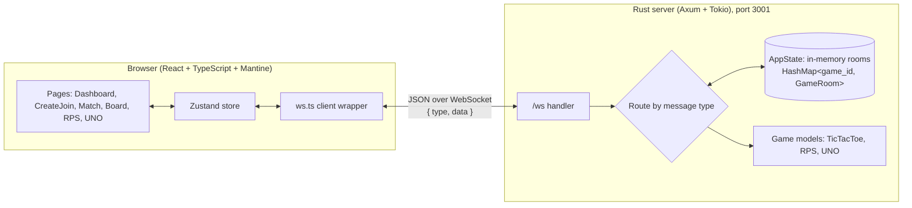

# Cargo Games

Real-time multiplayer browser games (Tic-Tac-Toe, Rock-Paper-Scissors and UNO) with in-room live chat, built on a Rust WebSocket server and a React + TypeScript front end.


Team project for **CMPS 401, Southeastern Louisiana University, Fall 2025**. This repository is my fork of the team repository [arlemoine/CMPS401](https://github.com/arlemoine/CMPS401). The game app lives in [`Project/`](Project); the rest of the repo holds the course's language-study material and programming assignments.

> **Note on this fork:** the UNO game and the Rock-Paper-Scissors screen were merged into the team repository after this fork was last synced. This fork's `main` already has the Rock-Paper-Scissors server logic, Tic-Tac-Toe and chat. To get the complete app, run `git pull upstream main` (it fast-forwards cleanly) or use the team repository.

## Overview

Players open the site, pick a game from the dashboard, enter a display name, and either create a room (which generates a short room code) or join one with a code. Everyone in the room shares one live game and one chat window. All game rules run on the server, which is the single source of truth: the browser only sends actions ("play this card", "mark B2") and draws whatever state the server broadcasts back.

There is no database. Rooms, players, chat history and game state are kept in server memory for the life of the process.

## Key features

- **Room-based matchmaking.** Create a room and share its code, or join an existing room by code. Joining a room that does not exist yet creates it.
- **Tic-Tac-Toe.** Server-side move validation, turn order, and win and draw detection for two players.
- **Rock-Paper-Scissors.** Two players submit choices; the server reveals both and resolves the round once both are in. Rounds can be reset without leaving the room.
- **UNO** (in the team repo, see note above). Full 108-card deck with Skip, Reverse, Draw Two, Wild and Wild Draw Four; a 7-card deal; a wild-color lock after a wild is played; draw and pass actions. Each player's hand is sent only to that player, while everyone else sees card counts.
- **Live chat** in every room, broadcast to all room members with timestamps.
- **Resilient client connection.** The WebSocket wrapper queues outgoing messages while the socket is connecting and flushes them once it opens.
- **Documented message protocol.** Every message type and payload is written up in [`Project/docs/message_protocol.md`](Project/docs/message_protocol.md), with manual test steps in [`Project/docs/backend_api_testing.md`](Project/docs/backend_api_testing.md).

## Architecture



How a message flows:

1. The client opens one WebSocket to `ws://127.0.0.1:3001/ws` (set by `VITE_WS_URL`).
2. Every message is JSON shaped as `{ "type": "...", "data": { ... } }`. The server deserializes it into a Rust enum (`ClientMessage`) with Serde, using the `type` tag to pick the variant: `Echo`, `GameRoom`, `Chat`, `TicTacToe`, `RockPaperScissors` (and `Uno` upstream).
3. A handler for that type updates the room's state inside a Tokio `RwLock`.
4. The resulting `ServerMessage` is broadcast to every connection in the room through per-client `mpsc` channels. When a client disconnects, its channel is removed from every room.

## Tech stack

| Layer | Technology |
| --- | --- |
| Backend | Rust (2024 edition), Axum 0.8 (WebSocket support), Tokio, Serde / serde_json, tracing, uuid, rand |
| Frontend | React 19, TypeScript, Vite, Mantine 8, React Router 7, Zustand, lucide-react |
| Transport | WebSockets with a JSON message protocol |
| Tooling | ESLint, Cargo unit tests, a tmux-based dev script (`scripts/run.sh`) |

## Project structure

```text
.
├── Project/                  # Cargo Games application
│   ├── server/               # Rust backend (Axum + Tokio)
│   │   └── src/
│   │       ├── main.rs       # router, /ws route, app state
│   │       ├── ws.rs         # per-connection loop, routing, room broadcast
│   │       ├── types.rs      # ClientMessage / ServerMessage enums and payloads
│   │       ├── models/       # GameRoom plus per-game models
│   │       └── routes/       # gameroom, chat, tictactoe, rockpaperscissors handlers
│   ├── client/               # React + TypeScript + Mantine frontend
│   │   └── src/{api,components,pages,state}
│   ├── docs/                 # architecture, message protocol, API testing guide
│   └── scripts/run.sh        # starts backend and frontend together in tmux
├── Docs/                     # course setup notes (git, SSH, Linux, remote access)
├── Language_Study/           # Rust language study (slides, sample programs, user manual)
└── Progamming_Assignments/   # course assignments in C, Fortran, PHP, JavaScript, Python, Rust
```

Course setup guides are in the [Documentation](Docs) folder.

## Getting started

**Prerequisites:** the Rust toolchain (`rustup`/`cargo`), Node.js LTS with npm, and `tmux` if you want the one-command script. The team's setup guide in [`Project/README.md`](Project/README.md) walks through installing these on Ubuntu.

### Option A: one command (Linux/macOS with tmux)

```bash
cd Project/scripts
./run.sh
```

The script creates `Project/client/.env` with `VITE_WS_URL`, starts the backend and frontend in a tmux session, and writes logs to `Project/logs/`.

### Option B: run each side manually

```bash
# Terminal 1: backend (listens on 127.0.0.1:3001)
cd Project/server
cargo run

# Terminal 2: frontend
cd Project/client
echo "VITE_WS_URL=ws://127.0.0.1:3001/ws" > .env
npm install
npm run dev
```

Then open <http://localhost:5173>. To try a game with two players, open a second browser window, create a room in one, and join it with the room code in the other.

### Configuration

| Name | Where | Purpose |
| --- | --- | --- |
| `VITE_WS_URL` | `Project/client/.env` | WebSocket URL the client connects to, e.g. `ws://127.0.0.1:3001/ws` |

The server's host, port (`3001`) and log level are set in `Project/server/src/config.rs`.

### Tests

```bash
cd Project/server
cargo test
```

## Team

Built by a three-person team. Names and handles come from the repository's commit history; the areas listed are where each person's commits are concentrated.

| Member | Main areas |
| --- | --- |
| Adriean Lemoine ([@arlemoine](https://github.com/arlemoine)) | Backend architecture: game rooms, chat, Tic-Tac-Toe model and API, message protocol docs |
| Adam Rodi | Rock-Paper-Scissors and UNO server APIs, front-end and back-end integration, docs |
| Riyaj Chaulagain ([@riyajclgn123](https://github.com/riyajclgn123)) | Frontend: Tic-Tac-Toe board and win logic, chat box, Rock-Paper-Scissors and UNO pages, game dashboard |

## Author

**Riyaj Chaulagain**, Computer Science student at Southeastern Louisiana University

- GitHub: [riyajclgn123](https://github.com/riyajclgn123)
- Portfolio: [riyajchaulagain.com.np](https://riyajchaulagain.com.np)
